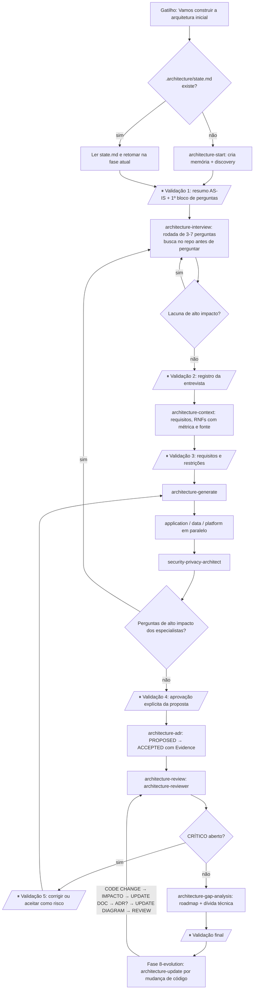

# Framework Global de Arquitetura para Claude Code — Análise e Desenho

Documento para o arquiteto. Resume a análise crítica do desenho original (11 agentes) e o desenho final adotado: **6 subagentes + 16 skills** (15 skills especializadas + 1 skill de entrada). Tudo é genérico (não depende de projeto) e fica instalado em `~/.claude/`; a memória de cada projeto vive em `.architecture/` dentro do repositório dele.

Rótulos de status usados em todo o framework: KNOWN, UNKNOWN, ASSUMPTION, PROPOSAL, DECISION, RISK, OPEN QUESTION; documentos DRAFT | REVIEWED | APPROVED; ADR PROPOSED | ACCEPTED | SUPERSEDED | REJECTED | DEPRECATED; radar ADOPT | TRIAL | ASSESS | HOLD | REJECT.

---

## 1. Análise crítica do desenho original

O desenho original previa 11 agentes. A plataforma impõe restrições que invalidam parte dele:

| # | Restrição da plataforma | Consequência no desenho original |
|---|---|---|
| R1 | Subagentes (tool Agent) **não conversam com o usuário**: rodam, devolvem um relatório e encerram | `requirements-interviewer` não consegue entrevistar; `architecture-orchestrator` não consegue pedir validação |
| R2 | Subagentes **não devem acionar outros subagentes** (aninhamento não confiável) | `architecture-orchestrator` como subagente não conseguiria delegar |
| R3 | Só a sessão principal fala com o usuário e delega | coordenação, entrevista e gates de aprovação precisam estar em **skills** da sessão principal |

Problemas de qualidade do desenho original:

| Problema | Impacto | Correção adotada |
|---|---|---|
| Orquestrador e entrevistador como agentes | inexequíveis (R1, R2) | viram skills (`architecture`, `architecture-interview`) |
| `solution-architect` e `integration-api-architect` separados | sobreposição em comunicação, filas, resiliência | fundidos em `application-architect` |
| `infrastructure-architect` e `devops-architect` separados | sobreposição em ambientes, deploy, backup, observabilidade | fundidos em `platform-architect` |
| `architecture-decision-manager` como agente | trabalho de template e regra de estado, sem necessidade de contexto isolado | vira skill `architecture-adr` |
| Nada impedia "decisão inventada" | risco de documentação com falsas certezas | rótulos de status, regra PROPOSAL→DECISION só com evidência, ADR ACCEPTED só com Evidence |
| Perguntas sem priorização | usuário sobrecarregado | blocos de 3–7, por impacto, com busca prévia no repositório |
| Sem memória entre sessões | perda de contexto | `.architecture/` versionada, com `state.md` |

## 2. Redundâncias identificadas

| Redundância | Onde estava | Resolução |
|---|---|---|
| Filas, mensageria e resiliência | solution-architect × integration-api-architect | `application-architect` (único dono) |
| Ambientes, deploy, pipelines | infrastructure-architect × devops-architect | `platform-architect` (único dono) |
| Backup/restore e observabilidade | infrastructure-architect × devops-architect | `platform-architect` (infra: backup/DR/observabilidade; devops: ambientes/CI/CD/runbooks, em arquivos disjuntos) |
| Registro de decisões | decision-manager × todos os arquitetos | só `architecture-adr` cria ADR; especialistas apenas propõem |
| Perguntas ao usuário | cada agente perguntando por conta própria | só a sessão principal pergunta; especialistas sugerem (até 7, priorizadas) e `architecture-generate` consolida numa única rodada |
| Revisão | cada agente "revisando" o próprio texto | só `architecture-reviewer`, independente |

## 3. Arquitetura simplificada

```
SESSÃO PRINCIPAL (skills — falam com o usuário, decidem o fluxo, delegam)
  architecture (entrada) ─ start · context · discover · interview · generate
                           api · data · infrastructure · devops · security
                           adr · tech-evaluation · review · gap-analysis · update
        │ delega (somente a sessão principal)
        ▼
SUBAGENTES (analisam e PROPÕEM; retornam relatório ≤ 40 linhas; não falam com o usuário)
  architecture-discovery · application-architect · data-architect
  platform-architect · security-privacy-architect · architecture-reviewer
        │ escrevem
        ▼
PROJETO:  .architecture/  (memória)      docs/architecture/  (documentação)
```

| Componente | Quantidade | Papel |
|---|---|---|
| Subagentes | 6 | análise especializada, escrita nos próprios arquivos |
| Skills | 16 | fluxo, entrevista, delegação, memória, ADR, gates |
| Templates | 30 | `~/.claude/skills/architecture/templates/` |
| Memória por projeto | 8 arquivos + `reviews/` | `.architecture/` |

## 4. Responsabilidades sem sobreposição

| Subagente | Escreve em | Lê | Nunca |
|---|---|---|---|
| `architecture-discovery` | `.architecture/known-facts.md` (seção discovery), `03-as-is/{architecture,applications,integrations,data,infrastructure}.md` (stack, módulos, CI/CD, observabilidade e autenticação como seções; lacunas → relatório → `.architecture/open-questions.md`/`assumptions.md`) | repositório inteiro, git log | propor TO-BE; julgar se está certo |
| `application-architect` | `04-to-be/{architecture,applications,integrations}.md`, `05-diagrams/{context,container,component}.md`, `05-diagrams/flows/*` | memória, AS-IS, requisitos | decidir; tocar dados/infra/segurança além de interfaces |
| `data-architect` | `03-as-is/data.md` (complemento), `04-to-be/data.md` | migrations, schema, ORM, memória | fechar modelo sem evidência; marcar não confirmado como decisão |
| `platform-architect` | `04-to-be/{infrastructure,observability,deployment}.md`, `05-diagrams/deployment.md`, `09-operations/{environments,observability,backup-restore,disaster-recovery,runbooks}.md` | Docker, CI/CD, IaC, ambientes (só nomes de variáveis) | introduzir complexidade sem justificativa; ler valores de segredos |
| `security-privacy-architect` | `04-to-be/security.md`, `08-security/{threat-model,privacy-lgpd,security-baseline}.md` (riscos → `.architecture/risks.md` via relatório) | tudo | expor segredos; afirmar conformidade sem evidência |
| `architecture-reviewer` | `.architecture/reviews/REVIEW-<AAAA-MM-DD>.md` | tudo | editar documentos revisados (só aponta) |

Regras comuns: todos retornam (a) o que escreveram, (b) itens de memória com Status e Source, (c) até 7 perguntas sugeridas por impacto, (d) ADRs propostos. Nenhum escreve em `06-decisions/` (só a skill `architecture-adr`) nem marca ACCEPTED. Exceção: no modo avaliação de tecnologia (acionado por `architecture-tech-evaluation`) o especialista escreve `07-technology/evaluations/<tecnologia>.md`.

## 5. Quem delega

| Ator | Pode delegar? | Observação |
|---|---|---|
| Sessão principal (skills) | **Sim** | única que aciona subagentes; paralelo quando arquivos de saída são disjuntos |
| Subagentes | **Não** | analisam, escrevem, retornam |
| Usuário | decide | só a aprovação explícita do usuário transforma PROPOSAL em DECISION |

| Skill | Delega para |
|---|---|
| `architecture`, `architecture-context`, `architecture-interview`, `architecture-adr`, `architecture-gap-analysis` | ninguém (trabalho na sessão principal) |
| `architecture-start`, `architecture-discover` | `architecture-discovery` |
| `architecture-api` | `application-architect` |
| `architecture-data` | `data-architect` |
| `architecture-infrastructure`, `architecture-devops` | `platform-architect` |
| `architecture-security` | `security-privacy-architect` |
| `architecture-review` | `architecture-reviewer` |
| `architecture-generate` | application + data + platform (paralelo) → security → reviewer |
| `architecture-update` | especialista do domínio afetado + reviewer |
| `architecture-tech-evaluation` | especialista do domínio (opcional) |

## 6. Skills por agente

| Subagente | Acionado por |
|---|---|
| `architecture-discovery` | `architecture-start`, `architecture-discover`, `architecture-update` |
| `application-architect` | `architecture-api`, `architecture-generate`, `architecture-update`, `architecture-tech-evaluation` |
| `data-architect` | `architecture-data`, `architecture-generate`, `architecture-update`, `architecture-tech-evaluation` |
| `platform-architect` | `architecture-infrastructure`, `architecture-devops`, `architecture-generate`, `architecture-update`, `architecture-tech-evaluation` |
| `security-privacy-architect` | `architecture-security`, `architecture-generate`, `architecture-update`, `architecture-tech-evaluation` |
| `architecture-reviewer` | `architecture-review` (chamada por `architecture-generate` e `architecture-update`) |

## 7. Fluxo de execução

Fluxo conceitual: DESCOBRIR → LER → CONHECIDO → LACUNAS → PERGUNTAR → REGISTRAR → ALTERNATIVAS → PROPOR → VALIDAR COM USUÁRIO → DOCUMENTAR → REVISAR → EVOLUIR.

Gatilho do fluxo completo: **"Vamos construir a arquitetura inicial deste projeto"**. Pontos ⏸ = parada obrigatória para validação do usuário.



Fases em `.architecture/state.md`: `0-init`, `1-discovery`, `2-interview`, `3-requirements`, `4-proposal`, `5-validation`, `6-documentation`, `7-review`, `8-evolution`.

Ordem e paralelismo em `architecture-generate`:

| Onda | Quem | Paralelo? | Por quê |
|---|---|---|---|
| 1 | `application-architect`, `data-architect`, `platform-architect` | sim (uma única mensagem) | arquivos de saída disjuntos |
| — | consolidação de perguntas sugeridas → 1 rodada de entrevista | — | evita 3 interrogatórios |
| 2 | `security-privacy-architect` | não | lê os resultados das três frentes |
| 3 | `architecture-reviewer` | não | independência: revisa por último |

## 8. Formato da memória (`.architecture/`)

Versionada no repositório do projeto; **sem segredos**. Inferido nunca vira KNOWN; PROPOSAL só vira DECISION com evidência de aprovação; todo item tem Source.

| Arquivo | Conteúdo | Campos-chave |
|---|---|---|
| `state.md` | fase atual, última execução por skill, último commit revisado, próximos passos, bloqueios | fase (`0-init`…`8-evolution`), HEAD revisado |
| `context.md` | resumo do sistema em 1 página | marcadores inline com IDs |
| `known-facts.md` | fatos verificáveis | `F-001`, fato, Status=KNOWN, Source (`repository`/`documentation`/`user`/`runtime`), evidência (`arquivo:linha` ou data da resposta) |
| `assumptions.md` | hipóteses | `A-001`, hipótese, Source (`inferred`/`architectural analysis`), motivo, como validar, status (OPEN/CONFIRMED→vira fato/REJECTED) |
| `open-questions.md` | perguntas | `Q-001`, pergunta, por que importa, bloqueia o quê, prioridade, rodada, status (OPEN/ANSWERED/DEFERRED), resposta+data |
| `decisions.md` | índice de ADRs + propostas sem ADR | `ADR-NNN` (status, data, evidence), `P-001` |
| `risks.md` | riscos | `R-001`, probabilidade, impacto, mitigação, dono, status |
| `interview-log.md` | rodadas de entrevista (append-only) | data, perguntas, respostas resumidas, itens de memória gerados |
| `reviews/` | relatórios do reviewer | `REVIEW-AAAA-MM-DD.md` |

Marcadores inline nos documentos de `docs/architecture/`: `[KNOWN · F-003]`, `[ASSUMPTION · A-002]`, `[PROPOSAL · P-002]`, `[DECISION · ADR-004]`, `[OPEN · Q-007]`, `[RISK · R-001]`.

Estrutura de `docs/architecture/` (árvore definida pelo usuário; nenhum arquivo fora dela):

```
docs/architecture/
README.md
01-context/      project-context.md, stakeholders.md, glossary.md, assumptions.md         (architecture-context)
02-requirements/ functional.md, non-functional.md, constraints.md, open-questions.md      (architecture-context)
03-as-is/        architecture.md, applications.md, integrations.md, data.md, infrastructure.md   (architecture-discovery; data.md + data-architect)
04-to-be/        architecture.md, applications.md, integrations.md                        (application-architect)
                 data.md                                                                  (data-architect)
                 infrastructure.md, observability.md, deployment.md                       (platform-architect)
                 security.md                                                              (security-privacy-architect)
05-diagrams/     context.md, container.md, component.md, flows/                           (application-architect)
                 deployment.md                                                            (platform-architect)
06-decisions/    ADR-NNN-*.md                                                             (somente architecture-adr)
07-technology/   technology-radar.md, evaluations/                                        (architecture-tech-evaluation)
08-security/     threat-model.md, privacy-lgpd.md, security-baseline.md                   (security-privacy-architect)
09-operations/   environments.md, observability.md, backup-restore.md, disaster-recovery.md, runbooks.md   (platform-architect)
10-roadmap/      architecture-roadmap.md, technical-debt.md                               (architecture-gap-analysis)
```

`01-context/assumptions.md` e `02-requirements/open-questions.md` são projeções de `.architecture/assumptions.md` e `.architecture/open-questions.md` (a memória prevalece, mesmos IDs). Lacunas do discovery não têm arquivo em `03-as-is/`: vão para `.architecture/open-questions.md` e `assumptions.md`; riscos vão para `.architecture/risks.md`. **Nenhum documento vazio é criado**: sem conteúdo com fonte, o arquivo não nasce (vira "Pendente" no README e pergunta em `open-questions.md`).

**IDs.** Memória: `F-`, `A-`, `Q-`, `P-`, `R-`, `ADR-`. Locais a documento: `RNF-`, `RF-`, `RES-`, `G-`, `TD-`, `RV-`. **IDs provisórios:** subagentes escrevem itens novos como `<TIPO>-novo-<n>` (`P-novo-1`, `Q-novo-1`, `A-novo-1`, `F-novo-1`, `R-novo-1`) e não escrevem em `decisions/open-questions/assumptions/risks`; a skill que delegou atribui os IDs finais, registra na memória e substitui as ocorrências, arquivo por arquivo, nos documentos (checagem: `grep -rn 'novo-' docs/architecture .architecture` = 0; o reviewer aponta restos). Exceção: `architecture-discovery` grava a seção discovery de `known-facts.md` já com `F-NNN` finais.

## 9. Templates de documentos

Local: `~/.claude/skills/architecture/templates/` (referenciados por caminho absoluto pelas skills).

| Template | Propósito |
|---|---|
| `state.md` | controle de fase, execuções, último commit revisado, próximos passos |
| `context.md` | resumo de 1 página do sistema |
| `known-facts.md` | tabela de fatos com Source e evidência + seção de discovery |
| `assumptions.md` | hipóteses com forma de validação |
| `open-questions.md` | perguntas priorizadas com impacto e bloqueio |
| `decisions.md` | índice de ADRs e propostas |
| `risks.md` | registro de riscos |
| `interview-log.md` | registro por rodada de entrevista |
| `README.md` | índice de `docs/architecture/` com legenda de status |
| `doc-section.md` | cabeçalho padrão de todo documento (status DRAFT/REVIEWED/APPROVED, fontes, marcadores inline) |
| `as-is.md` | arquitetura atual descoberta, com evidência e pontos em aberto (cada seção indica qual dos 5 arquivos de `03-as-is/` a recebe) |
| `to-be.md` | arquitetura proposta, rastreável a requisitos, com alternativas |
| `data-model.md` | CURRENT DATA MODEL × PROPOSED DATA MODEL (ER em Mermaid) |
| `non-functional.md` | RNFs com métrica, alvo e fonte |
| `constraints.md` | restrições duras (regulatória, infraestrutura, prazo, orçamento, equipe) com fonte |
| `functional.md` | requisitos funcionais com impacto arquitetural |
| `threat-model.md` | ativos, fronteiras de confiança, STRIDE leve, riscos priorizados |
| `security-baseline.md` | controles-base: autenticação, autorização, segredos, criptografia, auditoria |
| `privacy-lgpd.md` | inventário de dados pessoais e checklist de privacidade com evidência |
| `environments.md` | inventário de ambientes, paridade, variáveis (só nomes) |
| `backup-restore.md` | RPO/RTO, estratégia, procedimento e testes de restore |
| `disaster-recovery.md` | cenários de desastre, failover, ensaios |
| `runbooks.md` | procedimentos operacionais (um arquivo, uma seção por cenário real) |
| `technology-radar.md` | classificação ADOPT/TRIAL/ASSESS/HOLD/REJECT |
| `tech-evaluation.md` | avaliação com 15 critérios (nota 1–5 + justificativa + fonte) |
| `adr.md` | registro de decisão (ver item 10) |
| `review-report.md` | relatório do revisor independente, com checklist e severidade |
| `architecture-roadmap.md` | gap analysis AS-IS × TO-BE e ondas |
| `technical-debt.md` | dívida técnica com evidência, juros e gatilho |
| `diagrams.md` | C4Context/C4Container/C4Component, deployment, sequência, fluxo de dados (Mermaid), com nota "derivado de <doc>"; cada seção vira um arquivo de `05-diagrams/` |

## 10. Template de ADR (completo)

Nome do arquivo: `docs/architecture/06-decisions/ADR-NNN-titulo-curto.md`. Só para decisão relevante (afeta estrutura, custo, segurança, dados, operação, ou é difícil de reverter). **ACCEPTED exige Evidence de aprovação do usuário** (resposta registrada com data, PR ou ata); sem Evidence, permanece PROPOSED. Subagentes propõem; apenas a skill `architecture-adr` cria o arquivo.

````markdown
# ADR-NNN: <Título curto da decisão>

| Campo | Valor |
|---|---|
| **Status** | PROPOSED  <!-- PROPOSED | ACCEPTED | SUPERSEDED | REJECTED | DEPRECATED --> |
| **Date** | AAAA-MM-DD |
| **Evidence** | — <!-- obrigatório para ACCEPTED: resposta do usuário (data + rodada) | PR | ata --> |
| **Supersedes** | — |
| **Superseded by** | — |
| **Decisores** | <papéis> |
| **Origem** | <P-NNN / Q-NNN / skill que propôs> |

## Context
Situação e forças em jogo, com fatos marcados [KNOWN · F-NNN] e restrições (RES-NNN).

## Problem
Qual decisão precisa ser tomada e por que agora.

## Options
1. **Opção A — <nome>**: <descrição breve>
2. **Opção B — <nome>**: <descrição breve>
3. **Opção C — Não fazer nada**: manter a situação atual   <!-- incluir quando cabível; mínimo 2 opções -->

## Evaluation
| Critério | Peso | Opção A | Opção B | Opção C (nada) | Fonte |
|---|---|---|---|---|---|
| Atende RNF-NNN | alto | | | | |
| Complexidade operacional | alto | | | | |
| Custo | médio | | | | |
| Esforço de migração | médio | | | | |
| Risco de segurança/privacidade | alto | | | | |
| Reversibilidade | médio | | | | |

## Decision
Em PROPOSED: "Proposta: <opção> porque <razões ligadas à avaliação>".
Em ACCEPTED: texto final da decisão.

## Consequences
**Positivas (+)**
- ...

**Negativas (−)**
- ...

## Risks
| ID | Risco | Mitigação |
|---|---|---|
| R-NNN | ... | ... |

## Rollback
Passos para desfazer, custo e ponto de não retorno ("irreversível" deve ser explícito e justificado).

## Links
Documentos afetados, perguntas/hipóteses (Q-NNN, A-NNN), tech evaluation.
````

Para mudar uma decisão: criar novo ADR com `Supersedes`; o antigo vira SUPERSEDED (nunca reescrever o ADR aceito).

## 11. Processo de entrevista

Regras (skill `architecture-interview`, executada na sessão principal):

| Etapa | Regra |
|---|---|
| Preparar | ler memória; listar lacunas por área (objetivo, stakeholders, usuários, volume, disponibilidade, performance, escalabilidade, segurança, privacidade, integrações, dados, infraestrutura, restrições, orçamento, operação, deploy, observabilidade, DR, roadmap) |
| **Procurar antes de perguntar** (obrigatório) | docker-compose, `.env.example` (só nomes), manifests de pacote, migrations, código, docs, CI. Achou → registra KNOWN e **não pergunta a existência**; pergunta algo de maior valor citando o achado |
| Priorizar | restrições duras primeiro (regulatório/privacidade, infraestrutura obrigatória, integrações corporativas), depois disponibilidade/volume, prazo/orçamento/equipe, demais |
| Montar bloco | 3–7 perguntas relacionadas e específicas; cada uma com: por que importa, achado no repositório, opções/exemplos, "se não souber: qual hipótese adotamos?" |
| Perguntar | `AskUserQuestion` para múltipla escolha; texto livre para o resto |
| Registrar | `interview-log.md` + `open-questions.md` + fatos/hipóteses/riscos com **Source=user e data** |
| Nova rodada? | só se restar lacuna de **alto** impacto; média/baixa viram hipótese ou DEFERRED |

Técnicas: decompor em perguntas menores; restrições antes de preferências; separar fato de hipótese; pedir exemplo concreto; casos extremos; "o que pode dar errado?"; adaptar a rodada seguinte às respostas. Nunca despejar dezenas de perguntas.

### Exemplo genérico de 1 rodada (6 perguntas)

Contexto: sistema web de gestão de pedidos. A busca no repositório já encontrou: banco relacional no `docker-compose.yml`, serviço de cache no mesmo arquivo, pipeline de CI em `.github/workflows/ci.yml`, `.env.example` com `SMTP_HOST` e `PAYMENT_API_URL`, migrations com coluna `documento` na tabela `clientes`.

| # | Perguntas que seriam feitas **sem** a busca (descartadas) | Achado que as responde |
|---|---|---|
| — | "Que banco de dados usam?" | `docker-compose.yml:8` (banco relacional) |
| — | "Têm CI?" | `.github/workflows/ci.yml` |
| — | "Enviam e-mails? Integram com pagamento?" | `.env.example:14,15` |

| # | Pergunta (rodada 1 — tema: restrições duras) | Por que importa | Achado no repositório | Formato |
|---|---|---|---|---|
| 1 | Identifiquei a coluna `documento` em `clientes` (`migrations/001_clientes.sql:10`). Os dados armazenados de clientes estão sujeitos a alguma regulação de proteção de dados? Opções: sim (dados pessoais), sim (dados sensíveis), não, não sei | define criptografia, retenção, hospedagem e threat model | coluna de identificação pessoal | `AskUserQuestion` |
| 2 | A hospedagem é imposta (servidores próprios, nuvem específica) ou livre? Se não souber: adotamos "livre, em contêineres" como hipótese? | restringe toda a proposta de infraestrutura | só há `docker-compose.yml`, sem IaC | `AskUserQuestion` |
| 3 | Há um `PAYMENT_API_URL` no `.env.example`. A integração de pagamento é de um provedor imposto pelo negócio? Há contrato/SLA do provedor? | define resiliência e fallback da integração | variável de ambiente (valor não lido) | texto livre |
| 4 | Qual a indisponibilidade tolerável? Ex.: "até 4 h/mês em horário comercial" ou "24x7 sem paradas". Se não souber: adotamos 99,5% em horário comercial como hipótese? | dimensiona redundância, deploy e backup | nenhuma réplica no compose | `AskUserQuestion` |
| 5 | Qual o pior dia de carga esperado (usuários simultâneos e pedidos/hora)? Um exemplo concreto ajuda (ex.: campanha de fim de ano) | dimensionamento e uso do cache já presente | cache no compose sem política documentada | texto livre |
| 6 | Quem opera o sistema em produção (equipe interna, terceiro) e com quais competências? Isso limita complexidade aceitável (ex.: dispensa orquestrador de contêineres) | decide ferramentas operáveis pela equipe | pipeline faz build mas não há registro de deploy | texto livre |

Depois da rodada: `interview-log.md` ganha a "Rodada 1"; respostas viram fatos (`Source=user`, data) ou hipóteses (se "não sei"); a skill decide se há lacuna de alto impacto para uma 2ª rodada (ex.: se a resposta 1 foi "dados sensíveis", aprofundar retenção e base legal).

## 12. Critérios de conclusão

| Etapa | Concluída quando |
|---|---|
| Discovery | inventário de stack, módulos, dados, integrações, infra e CI/CD com evidência (arquivo) por item; lacunas listadas; nenhum julgamento de valor |
| Entrevista (rodada) | todas as perguntas com resposta ou DEFERRED (com hipótese); memória atualizada com Source=user e data |
| Requisitos | RNFs com métrica e fonte; restrições; open questions priorizadas |
| Proposta TO-BE | cada elemento rastreável a requisito/fato; alternativas para escolhas relevantes; propostas como PROPOSAL; ADRs PROPOSED |
| Validação | usuário aprovou explicitamente (data/resposta registrada) → ADRs ACCEPTED com Evidence |
| Documentação | docs sem contradição com memória e código; diagramas derivados; nenhum documento vazio |
| Revisão | relatório do reviewer sem itens CRÍTICO abertos (ou aceitos pelo usuário como risco) |
| Evolução | `state.md` com último commit revisado; `architecture-update` aponta docs obsoletos |
| **Global** | **zero decisões inventadas; zero fato sem Source; zero ACCEPTED sem Evidence** |

---

## Instalação

1. Revisar o conteúdo em `staging/` (agentes, skills e templates).
2. `bash staging/install.sh --dry-run` (mostra o que seria copiado e o que já existe).
3. `bash staging/install.sh` (copia para `~/.claude/agents/` e `~/.claude/skills/`; qualquer item já existente com o mesmo nome e conteúdo diferente é salvo antes em `~/.claude/arch-framework-backup-<timestamp>/`; reexecutar é seguro).
4. Reiniciar a sessão do Claude Code. Em um projeto, dizer: **"Vamos construir a arquitetura inicial deste projeto"**.
