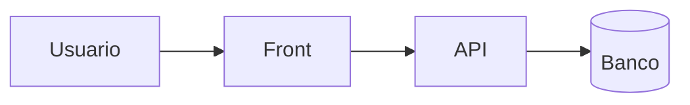
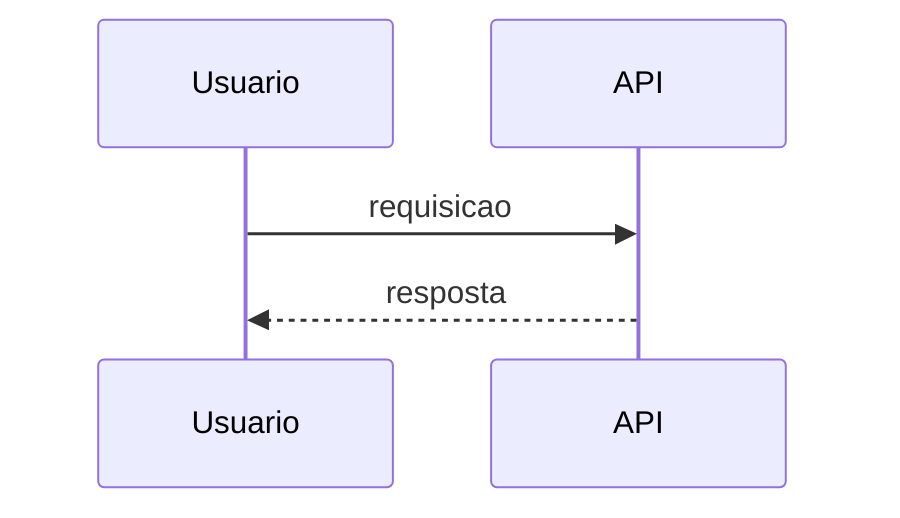
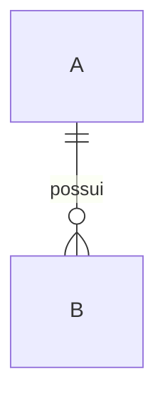

<!--
TEMPLATE do Documento de Arquitetura de Software (ISO/IEC/IEEE 42010).
Renderizado por render_pdf.py (ver README.md desta pasta). Comentários HTML somem no PDF.

REGRAS (valem para quem preenche — o subagente architecture-documenter):
- Substituir TODO {{placeholder}}. O que não tiver fonte vira "A definir" (célula/linha) e entra em
  .architecture/open-questions.md. Nada inventado; nada de número sem fonte.
- Títulos SEM numeração: o renderizador numera # (1), ## (1.1), ### (1.1.1), #### (1.1.1.1).
  ##### (A), B)...) não é numerado, mas entra no sumário. {.nonum} no fim do título suprime o número.
- Listas aninhadas com 4 espaços. Tabelas em Markdown (| a | b |). Negrito para rótulos ("**Responsável por:**").
- Sem IDs internos (F-/A-/Q-/R-/P-), sem marcadores [KNOWN ·...], sem caminhos locais, sem segredos,
  sem termos de IA. ADR pode ser citado pelo número na tabela de decisões (seção 6) — só ali.
- AS-IS × TO-BE: se o documento cobre as duas, cada visão traz subtítulos "Arquitetura atual" e
  "Arquitetura proposta"; uma só: omitir o rótulo. Proposta nunca é escrita como fato consumado.
- Seção que o repositório não permite preencher: manter o título e escrever "A definir." + 1 linha do que falta.
- Diagramas: bloco ```mermaid com a 1ª linha "%% titulo: <legenda>". ≤ 12 nós por diagrama; dividir se maior.
  Rótulos de nós sem acentos ou entre aspas. Estilo azul C4 aplicado automaticamente.
-->

# Identificação do Sistema

```kv
Nome do Sistema: {{nome}}
Versão: {{versão do sistema / marco, ex.: 1.0 (MVP + Incremento 1)}}
Arquitetura documentada: {{Atual (AS-IS) | Proposta (TO-BE) | Atual e proposta}}
Data da inception: {{mês / ano}}
Data deste documento: {{dd/mm/aaaa}}
Autores/Responsáveis: {{nome (papel) — organização}}
```

## Objetivos: {.nonum}

<!-- Fonte: .architecture/context.md (objetivo do sistema) e docs/architecture/01-context/project-context.md. -->

- {{objetivo principal do sistema}}
    - {{desdobramento}}
- {{objetivo 2}}

# Stakeholders

<!-- Fonte: 01-context/stakeholders.md. Colunas fixas. Responsabilidades = o que a pessoa/grupo FAZ no/com o sistema. -->

| Stakeholder | Papel / Interesse no Sistema | Responsabilidades |
|---|---|---|
| {{grupo}} | {{interesse}} | {{responsabilidades}} |

# Preocupações (Concerns)

<!-- Fonte: 02-requirements/non-functional.md e constraints.md (uma linha por categoria com requisito/alvo real). -->

| Categoria | Descrição da Preocupação Arquitetural |
|---|---|
| Segurança | {{...}} |
| Desempenho | {{...}} |
| Escalabilidade | {{...}} |
| Conformidade | {{...}} |
| Manutenibilidade | {{...}} |
| Auditabilidade | {{...}} |
| Usabilidade | {{... (omitir categorias sem requisito)}} |

# Pontos de Vista (Viewpoints)

<!-- Os 4 pontos de vista são fixos; a notação é a efetivamente usada nos diagramas do documento. -->

| Ponto de Vista | Objetivo | Stakeholders Atendidos | Notação/Modelo Usado |
|---|---|---|---|
| Lógico | Organizar módulos, camadas e domínios de negócio. | {{papéis}} | {{ex.: C4 Model (Mermaid)}} |
| Processos | Descrever fluxos de execução e interações. | {{papéis}} | {{ex.: diagrama de sequência}} |
| Implantação | Mostrar topologia, containers e integrações. | {{papéis}} | {{ex.: diagrama de implantação}} |
| Informação/Dados | Modelar dados e integrações externas. | {{papéis}} | {{ex.: ERD}} |

# Visões (Views)

## Visão Lógica

<!-- Fonte: 04-to-be/architecture.md, applications.md, integrations.md, 05-diagrams/{context,container,component}.md (TO-BE);
     03-as-is/architecture.md, applications.md (AS-IS). -->

### Camadas e limites

#### Camada de Apresentação

- **{{Front/Cliente}} ({{tecnologia}}):** {{o que entrega}}.



#### Camada de Aplicação (APIs)

- **{{API}} ({{tecnologia}}):** {{responsabilidade, estilo (REST/…), consumidores}}.

#### Serviços de Aplicação (Application Layer Services)

{{Frase curta: quem acessa os serviços e o que eles garantem. Use "Componentes de Aplicação" se o sistema não tem a noção de serviço.}}

##### A) {{NomeDoServico}}

**Responsável por:**
{{responsabilidade em 1–2 linhas}}

**Principais operações:**

- {{operação}}

**Orientação de uso:**
{{quem chama / limites (leitura x escrita)}}

##### Resumo de Interdependências

| Serviço | Depende de | Produz / Envia para |
|---|---|---|
| {{ServicoA}} | {{...}} | {{...}} |

#### Camada de Infraestrutura

- **Banco de Dados:** {{tecnologia}}.
- **Armazenamento de Arquivos:** {{tecnologia/A definir}}.
- **Execução:** {{plataforma}}.
- **Mensageria & Filas:** {{...}}.
- **Observabilidade:** {{...}}.

### Domínio e relacionamentos

<!-- Fonte: 04-to-be/data.md / 03-as-is/data.md. Blocos "N) Nome" do documento de referência viram ##### aqui. -->

##### 1) {{Agrupamento}}

- **Relações:** {{...}}
- **Descrição:** {{...}}

### Módulos Funcionais

- **{{Módulo}}:** {{o que faz}}.

### Integrações & Eventos

- **{{Integração}}:** {{direção, protocolo, consumidor/produtor}}.

### Fluxos Lógicos Essenciais

- {{origem}} → {{serviço}} → {{destino}} ({{resultado}}).

## Visão de Processos

<!-- Fonte: 05-diagrams/flows/*.md, 04-to-be/applications.md, integrations.md. Um subtítulo por fluxo real. -->

{{Frase de abertura: o que os processos descrevem.}}

### {{Nome do processo}}

- **Fluxo geral:**
    - {{passo}}
- **Serviços envolvidos:** {{lista}}



## Visão de Implantação

<!-- Fonte: 04-to-be/infrastructure.md, deployment.md, observability.md, 05-diagrams/deployment.md, 09-operations/environments.md.
     Só nomes de variáveis/segredos, nunca valores. -->

### Plataforma / Ambiente de Execução

- {{...}}

### Componentes em Execução

- **{{componente}}:** {{função}}.

### Serviços Gerenciados / de Apoio

- {{...}}

### Mensageria & Filas

- {{... ou A definir}}

### Observabilidade

- {{...}}

### Topologia / Exposição

- {{entrada pública → ... → serviços}}

### Segurança & SSL

- {{...}}

### Deploy / CI-CD

- {{...}}

### Configuração por Ambiente

- {{ambientes, réplicas, segredos por nome, backups (RPO/RTO se houver)}}

## Visão de Informação

<!-- Fonte: 04-to-be/data.md, 03-as-is/data.md, 08-security/privacy-lgpd.md. -->

**Camada de Persistência:**
{{onde cada tipo de dado vive; arquivos x banco; logs e auditoria}}

| Entidade | Descrição | Relacionamentos |
|---|---|---|
| {{Entidade}} | {{...}} | {{1:N com ...}} |



# Decisões Arquiteturais

<!-- Fonte: .architecture/decisions.md + 06-decisions/ADR-*.md.
     ADR ACCEPTED (com Evidence) -> Situação "Decisão". ADR PROPOSED / P-NNN -> "Proposta". REJECTED/SUPERSEDED -> omitir
     (ou citar em 7.2 como alternativa descartada, se houver motivo registrado). Nunca promover proposta a decisão. -->

| Decisão | Justificativa | Impacto | Situação |
|---|---|---|---|
| {{ADR-NNN — título}} | {{motivo registrado}} | {{consequência}} | Decisão |
| {{título}} | {{...}} | {{...}} | Proposta |

# Raciocínio e Justificativas

<!-- Fonte: contexto/motivadores dos ADRs, 02-requirements, 10-roadmap/architecture-roadmap.md, 03-as-is x 04-to-be. -->

{{Parágrafo: de onde veio a arquitetura e o que a motiva (AS-IS → TO-BE, quando aplicável).}}

## Decisões Arquiteturais Principais

- **{{Decisão principal}}:** {{explicação}}

## Justificativas Técnicas

- **{{Atributo de qualidade}}:** {{como a arquitetura o atende (ligado a requisito)}}.

# Correspondências (Concerns × Visões)

<!-- Seção 8 (a referência pula de 7 para 9). Matriz derivada das seções 3, 4 e 5: onde cada preocupação é tratada.
     Só relacionar o que o documento realmente trata. -->

| Preocupação | Visões que a tratam | Decisões relacionadas |
|---|---|---|
| {{Segurança}} | {{5.3 Implantação; 5.1 Lógica}} | {{ADR-NNN ou —}} |

# Conformidade e Padrões

<!-- Só padrões efetivamente adotados/exigidos (fonte: constraints.md, privacy-lgpd.md, ADRs). -->

| Norma / Framework | Aplicação |
|---|---|
| ISO/IEC/IEEE 42010 | Estrutura da documentação arquitetural. |
| {{LGPD / OWASP / outro}} | {{aplicação}} |

# Referências

- {{documento / norma / repositório}}
- ISO/IEC/IEEE 42010:2011
