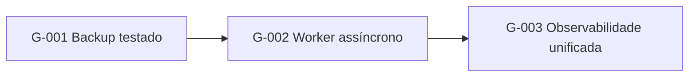

# Roadmap de Arquitetura — <Nome do Sistema>

<!--
Local: `docs/architecture/10-roadmap/architecture-roadmap.md`. Gerado por `architecture-gap-analysis` a partir de AS-IS × TO-BE.
Cada item: lacuna (gap) AS-IS → TO-BE, esforço relativo (P/M/G), dependências, risco, ADR/Requisito relacionado.
Ordenar por: dependência técnica, depois valor/risco. Datas só se o usuário forneceu (senão: "horizonte", não data).
Item sem origem em gap documentado NÃO entra.
Não criar este documento se TO-BE não existe.
-->

| Campo | Valor |
|---|---|
| **Status do documento** | DRAFT |
| **Última atualização** | AAAA-MM-DD |
| **Base** | `../03-as-is/architecture.md` × `../04-to-be/architecture.md` |

## 1. Gap Analysis (AS-IS × TO-BE)

| ID | Área | AS-IS (evidência) | TO-BE (proposta) | Gap | Esforço | Risco | Relacionado |
|---|---|---|---|---|---|---|---|
| G-001 | Dados | Sem rotina de backup testada [KNOWN · F-0NN] | Backup + restore testado, RPO 1 h [PROPOSAL · P-0NN] | Falta rotina e teste | M | alto | RNF-003, ADR-0NN |
| G-002 | Aplicação | Processamento síncrono [KNOWN · F-0NN] | Worker assíncrono [PROPOSAL · P-0NN] | Componente novo | G | médio | RNF-005, ADR-002 |

## 2. Plano em ondas

| Onda | Horizonte | Objetivo | Itens (G-NNN) | Pré-requisitos | Critério de saída |
|---|---|---|---|---|---|
| 1 | curto | Reduzir risco operacional | G-001 | ADR-0NN ACCEPTED | Restore testado com RTO medido |
| 2 | médio | Desacoplar processamento | G-002 | Onda 1 | Worker em produção com monitoramento |

## 3. Dependências e riscos do plano
| Risco | Itens afetados | Mitigação |
|---|---|---|
| [RISK · R-0NN] <risco> | G-002 | <mitigação> |

## 4. Decisões necessárias do usuário
| Decisão | Bloqueia | Pergunta |
|---|---|---|
| Aprovar ADR-002 | G-002 | [OPEN · Q-0NN] |

## 5. Fora do roadmap (por enquanto)
- <item> — motivo
