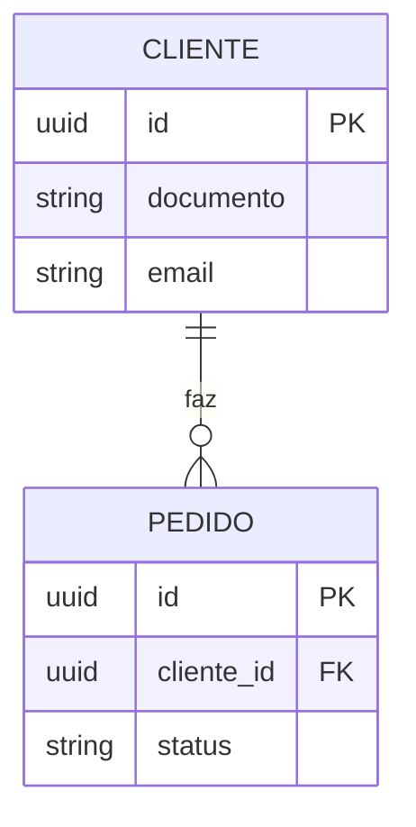
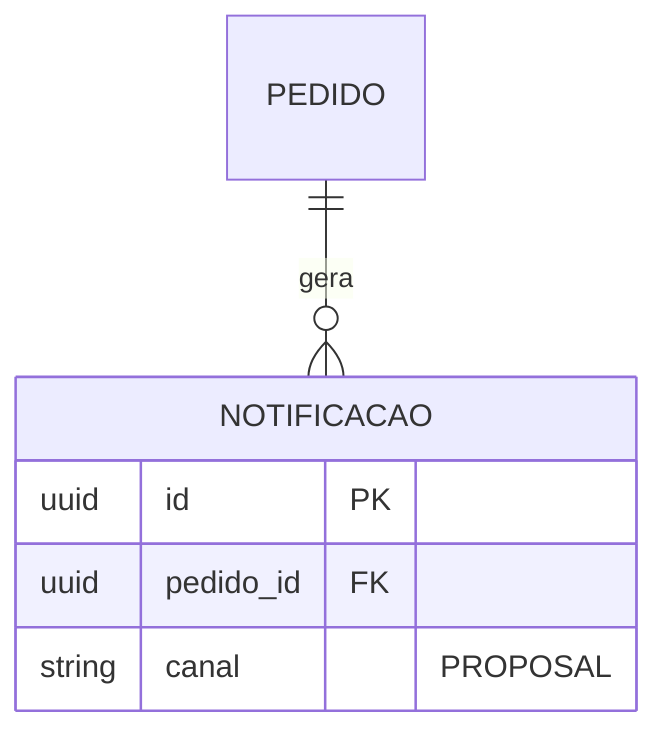

# Modelo de Dados — <Nome do Sistema>

<!--
Local: `docs/architecture/04-to-be/data.md` (complemento AS-IS em `03-as-is/data.md`). Escrito por `data-architect`.
Duas partes SEPARADAS:
- CURRENT DATA MODEL: o que existe (migrations, schema, ORM). Só KNOWN, com evidência.
- PROPOSED DATA MODEL: o que se propõe. Toda entidade/campo novo tem status DRAFT | PROPOSAL | OPEN.
Proibido: fechar modelo sem evidência; marcar não confirmado como decisão; listar valores reais de dados pessoais.
Dados pessoais/sensíveis: marcar classificação (pessoal, sensível, público) e base de retenção quando conhecida.
Diagramas ER em Mermaid (erDiagram) — derivados deste documento.
-->

| Campo | Valor |
|---|---|
| **Status do documento** | DRAFT |
| **Última atualização** | AAAA-MM-DD |
| **Fontes** | migrations (`<pasta>`), ORM (`<pasta>`), `.architecture/known-facts.md` |

## 1. CURRENT DATA MODEL

### 1.1 Armazenamentos
| Armazenamento | Tipo | Uso | Evidência |
|---|---|---|---|
| <SGBD principal> | relacional | transacional | `docker-compose.yml:8` [KNOWN · F-002] |

### 1.2 Entidades atuais
| Entidade | Tabela | Campos-chave | Relacionamentos | Dados pessoais? | Evidência |
|---|---|---|---|---|---|
| Cliente | `clientes` | `id`, `documento`, `email` | 1:N Pedido | sim (pessoal) | `migrations/001_*.sql:10` [KNOWN · F-010] |
| Pedido | `pedidos` | `id`, `cliente_id`, `status` | N:1 Cliente | não | `migrations/002_*.sql:5` [KNOWN · F-011] |

### 1.3 Observações sobre o estado atual
- Migrations: <ferramenta, quantidade, última data> [KNOWN · F-0NN]
- Índices relevantes: <lista> | Lacuna: <o que não foi possível confirmar> [OPEN · Q-0NN]

## 2. PROPOSED DATA MODEL

### 2.1 Mudanças propostas
| Entidade / campo | Mudança | Status | Motivo (requisito/fato) | Impacto de migração |
|---|---|---|---|---|
| `pedidos.canal` | novo campo | PROPOSAL | RF-004 [PROPOSAL · P-004] | backfill necessário |
| Entidade `Notificacao` | nova | DRAFT | RNF-005 | nova tabela, sem impacto em dados existentes |
| Particionamento de `pedidos` | avaliar | OPEN | volume desconhecido [OPEN · Q-002] | — |

### 2.2 Alternativas consideradas
| Escolha | Opção A | Opção B | Não fazer nada | ADR |
|---|---|---|---|---|
| Armazenar histórico de status | Tabela de eventos | Coluna JSON | Sem histórico | ADR-005 (PROPOSED) |

## 3. Ciclo de vida e retenção
| Dado | Classificação | Retenção | Descarte | Fonte |
|---|---|---|---|---|
| Dados cadastrais de cliente | pessoal | [OPEN · Q-0NN] | [OPEN · Q-0NN] | — |

## 4. Estratégia de migração
- Ferramenta atual: <x> [KNOWN · F-0NN]
- Passos propostos: <lista> [PROPOSAL · P-0NN]
- Rollback: <como reverter cada passo>

## 5. Riscos e pontos em aberto
- [RISK · R-00N] <risco>
- [OPEN · Q-00N] <pergunta>
