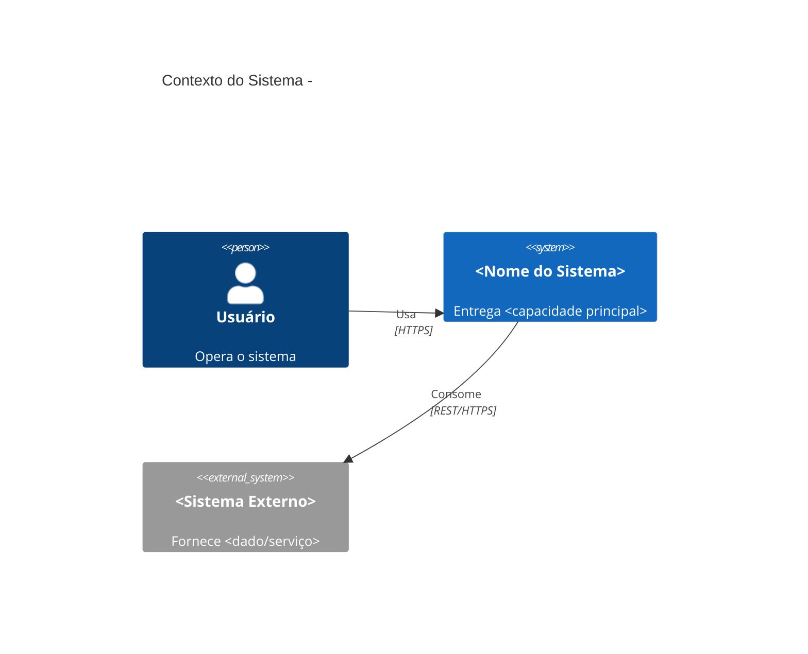
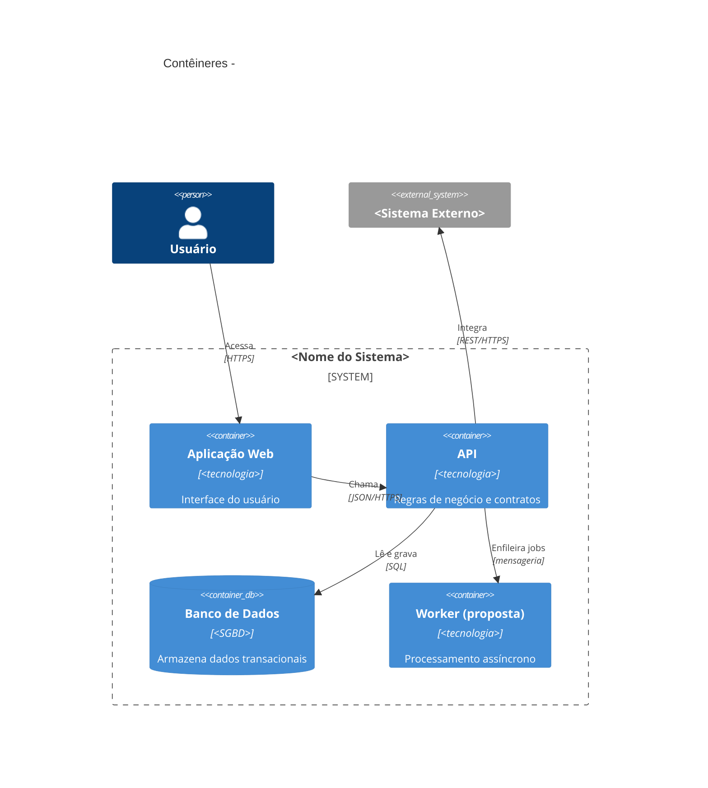
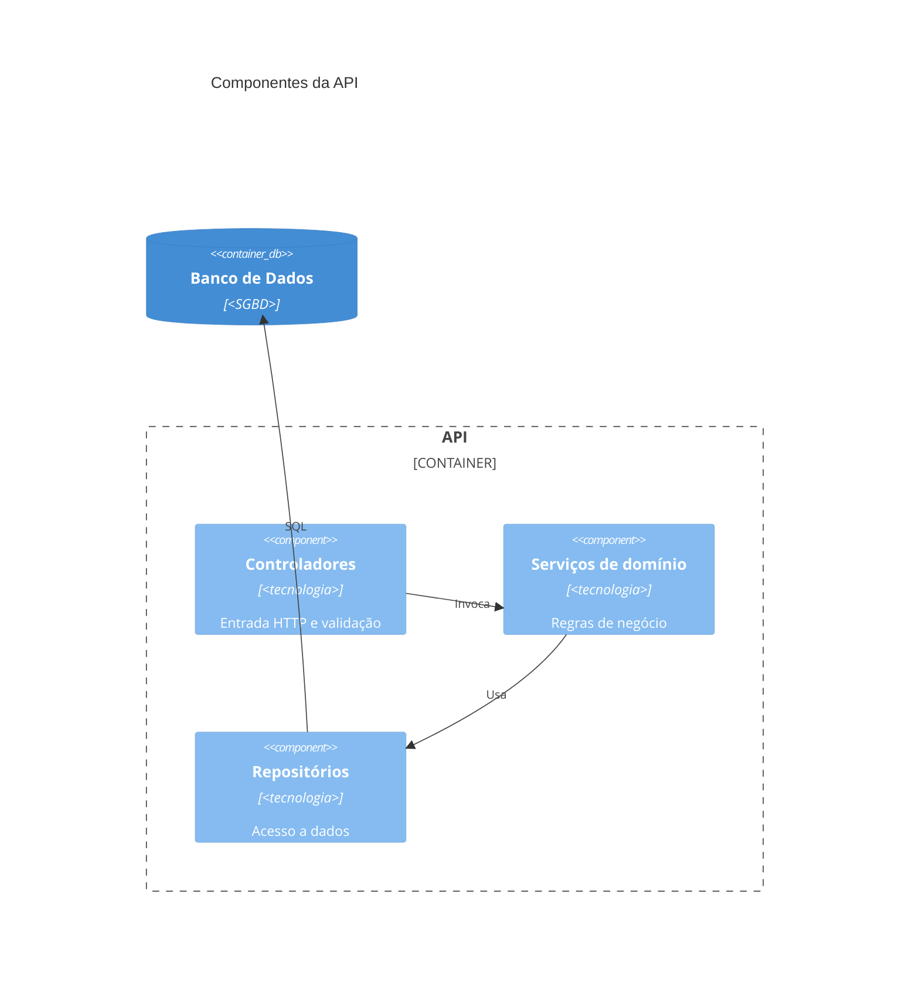
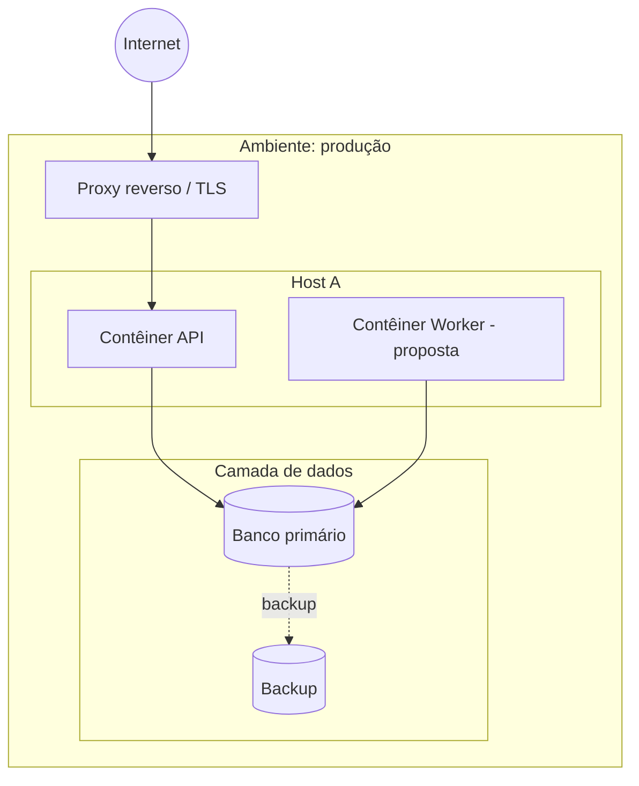
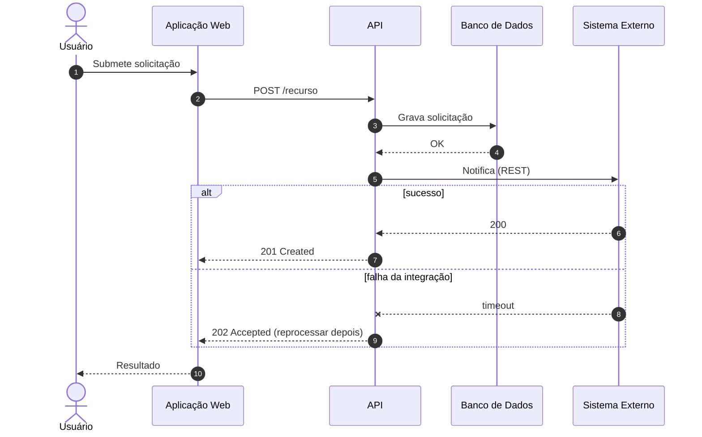
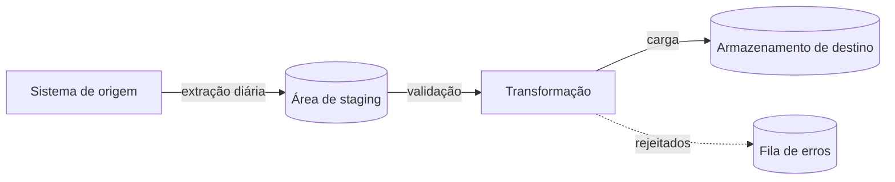

# Diagramas — <Nome do Sistema>

<!--
Este modelo reúne todos os tipos só para referência. Na instância, CADA seção vira um arquivo próprio em `docs/architecture/05-diagrams/` (nunca um diagrams.md único): seção 1 → `context.md`; 2 → `container.md`; 3 → `component.md`; 4 → `deployment.md`; 5 e 6 → `flows/<fluxo>.md` (um arquivo por fluxo); a seção 7 (mapa de derivação) vira a última seção de cada arquivo, só com a sua linha.
Escritos por `application-architect` (context/container/component/flows) e `platform-architect` (deployment).
REGRAS:
- Diagrama é DERIVADO de um documento: cada bloco tem a nota "Derivado de: <doc>" e a data. Nunca desenhar o que o texto não afirma.
- Elementos propostos (TO-BE) são distinguíveis dos existentes (rótulo "(proposta)" ou classe/estilo).
- Só criar diagrama quando o documento fonte tem conteúdo. Nunca criar diagrama vazio.
- Mermaid válido: nomes de nós sem espaços/acentos nos IDs; rótulos entre aspas quando houver caracteres especiais.
- Atualizar o diagrama sempre que o documento fonte mudar (architecture-update).
-->

| Campo | Valor |
|---|---|
| **Status do documento** | DRAFT |
| **Última atualização** | AAAA-MM-DD |

## 1. Contexto (C4 nível 1)

> Derivado de: `../04-to-be/architecture.md` §2 — AAAA-MM-DD

## 2. Contêineres (C4 nível 2)

> Derivado de: `../04-to-be/architecture.md` §3 — AAAA-MM-DD

## 3. Componentes (C4 nível 3) — <contêiner detalhado>

> Derivado de: `../04-to-be/applications.md` — AAAA-MM-DD

## 4. Implantação (deployment)

> Derivado de: `../04-to-be/infrastructure.md` e `../09-operations/environments.md` — AAAA-MM-DD

## 5. Sequência — <fluxo principal>

> Derivado de: `../04-to-be/integrations.md` §<n> — AAAA-MM-DD

## 6. Fluxo de dados / integração

> Derivado de: `../04-to-be/data.md` e `../04-to-be/integrations.md` — AAAA-MM-DD

## 7. Mapa de derivação

| Diagrama | Documento fonte | Atualizado em | Em sincronia? |
|---|---|---|---|
| Contexto | `04-to-be/architecture.md` | AAAA-MM-DD | sim |
| Contêineres | `04-to-be/architecture.md` | AAAA-MM-DD | sim |
