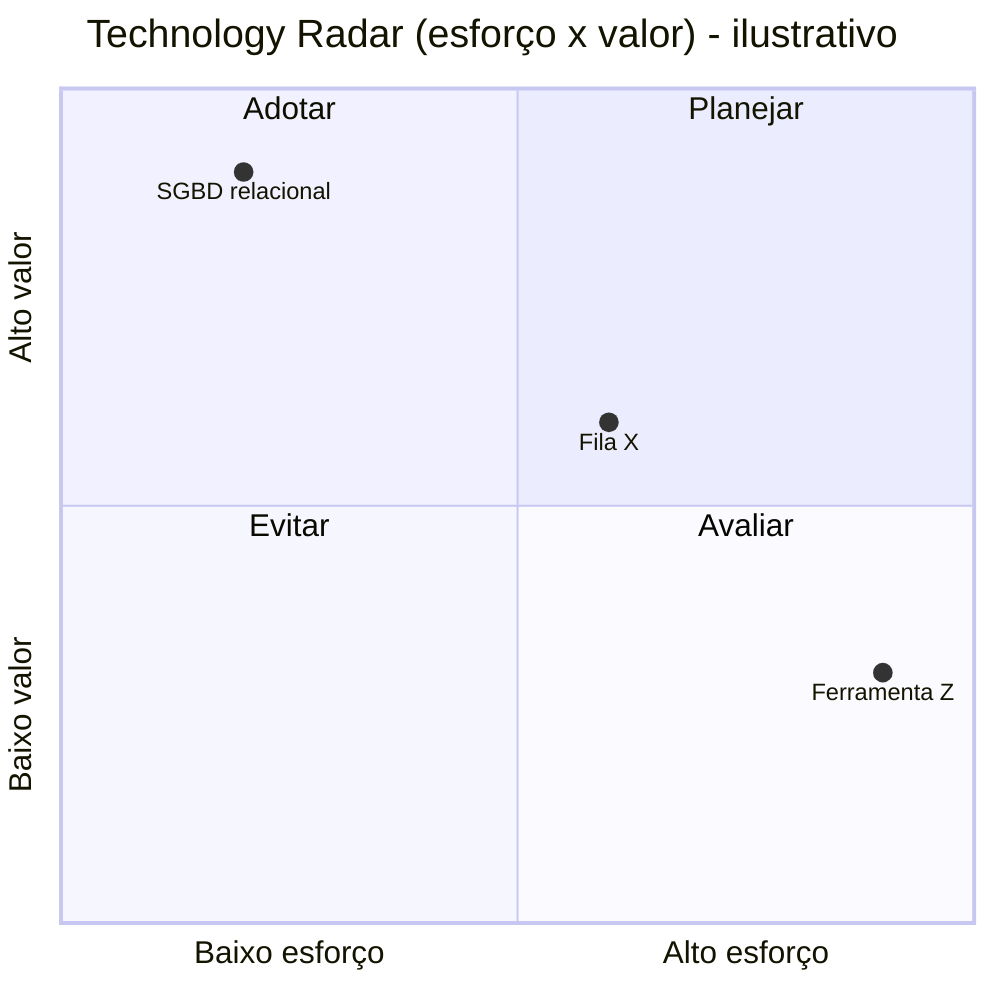

# Technology Radar — <Nome do Sistema>

<!--
Local: `docs/architecture/07-technology/technology-radar.md`.
Inventário das tecnologias em uso ou consideradas, com classificação:
- ADOPT: usar; recomendado como padrão.
- TRIAL: usar em escopo limitado para validar.
- ASSESS: investigar; ainda sem compromisso.
- HOLD: não iniciar novos usos; manter onde já existe.
- REJECT: avaliada e descartada (registrar motivo).
Regras:
- Toda classificação aponta para uma tech-evaluation (`07-technology/evaluations/<nome>.md`) ou para fato/ADR. Sem justificativa técnica = não classificar.
- Proibido justificar com "é moderno", "todo mundo usa", "é tendência".
- Tecnologia atual descoberta no repo entra como [KNOWN · F-NNN] com classificação "ADOPT (existente)" ou HOLD só com justificativa.
-->

**Última atualização:** AAAA-MM-DD

| Tecnologia | Categoria | Classificação | Em uso hoje? | Justificativa (resumo) | Evaluation / ADR | Marcador |
|---|---|---|---|---|---|---|
| <SGBD relacional> | Dados | ADOPT | sim | Atende transações e consultas; equipe conhece | ADR-001 | [DECISION · ADR-001] |
| <fila de mensagens X> | Integração | ASSESS | não | Candidata para processamento assíncrono | `evaluations/fila-x.md` | [PROPOSAL · P-0NN] |
| <biblioteca Y> | Frontend | HOLD | sim | Mantenedor sem releases há 2 anos | `evaluations/biblioteca-y.md` | [KNOWN · F-0NN] |
| <ferramenta Z> | Infra | REJECT | não | Complexidade operacional incompatível com a equipe | `evaluations/ferramenta-z.md` | [OPEN · Q-0NN] |

## Visão por categoria

## Mudanças desde a última atualização
| Data | Tecnologia | De → Para | Motivo |
|---|---|---|---|
| AAAA-MM-DD | <tecnologia> | ASSESS → TRIAL | resultado do piloto |
