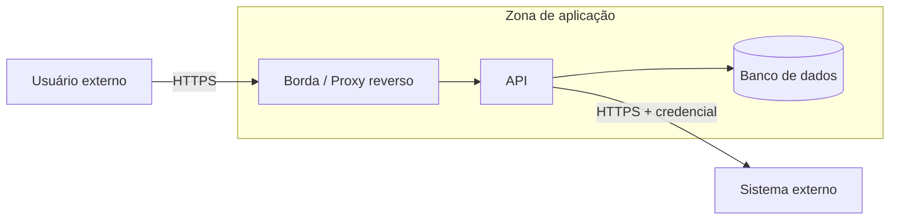

# Threat Model — <Nome do Sistema>

<!--
Local: `docs/architecture/08-security/threat-model.md`. Escrito por `security-privacy-architect`. Controles-base (autenticação, autorização, segredos, criptografia, auditoria) ficam em `security-baseline.md`; privacidade/LGPD em `privacy-lgpd.md`.
STRIDE leve: por fronteira de confiança/componente, listar só ameaças plausíveis (não preencher a matriz inteira por obrigação).
Proibido: expor segredos; afirmar conformidade com LGPD (ou lei equivalente) sem evidência. Sem evidência = "não verificado" + [OPEN].
Controles existentes só com evidência (KNOWN). Controles propostos = PROPOSAL.
-->

| Campo | Valor |
|---|---|
| **Status do documento** | DRAFT |
| **Última atualização** | AAAA-MM-DD |
| **Escopo** | <componentes e fluxos analisados> |
| **Base** | `../04-to-be/architecture.md`, `../03-as-is/*`, `.architecture/risks.md` |

## 1. Ativos e classificação
| Ativo | Classificação | Onde reside | Evidência |
|---|---|---|---|
| Dados cadastrais de clientes | pessoal | banco principal | [KNOWN · F-010] |
| Credenciais de integração | segredo | gerenciador de segredos / variáveis (apenas nomes) | [OPEN · Q-0NN] |

## 2. Fronteiras de confiança

## 3. Análise STRIDE (leve)

| Componente / fluxo | S Spoofing | T Tampering | R Repudiation | I Info disclosure | D DoS | E Elevation | Controle existente / proposto | Marcador |
|---|---|---|---|---|---|---|---|---|
| Login na API | credencial roubada | — | falta de trilha de auditoria | — | força bruta | — | MFA, rate limit, log de auditoria | [PROPOSAL · P-0NN] |
| Banco de dados | — | acesso direto indevido | — | vazamento de dados pessoais | — | privilégio excessivo da conta da aplicação | menor privilégio, criptografia em repouso | [OPEN · Q-0NN] |

## 4. Riscos de segurança priorizados
<!-- Fonte de verdade dos riscos: `.architecture/risks.md` (R-NNN). Aqui, a visão priorizada do threat model. -->
| ID | Risco | Probabilidade | Impacto | Mitigação proposta | Status |
|---|---|---|---|---|---|
| R-0NN | Vazamento de dados pessoais por conta de aplicação com privilégio excessivo | média | alta | menor privilégio + auditoria | OPEN |

## 5. Propostas de ADR
- <título> — motivo — ver `.architecture/decisions.md` (P-0NN)
